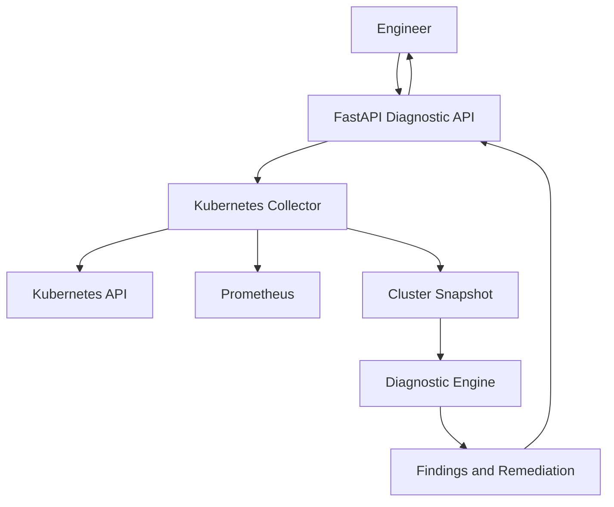

# AI Kubernetes Troubleshooting Agent

An intelligent, read-only Kubernetes troubleshooting tool that collects cluster health data, analyzes workload and infrastructure issues, and returns evidence-based diagnostic findings with remediation guidance.

The project integrates Kubernetes API data with Prometheus metrics to help engineers investigate common cluster incidents.

> **Project status:** Backend diagnostic API is implemented. Frontend dashboard, LLM-powered explanations, and public demo deployment are planned enhancements.

## Overview

Troubleshooting Kubernetes incidents often requires checking pod states, deployment rollouts, events, node conditions, logs, and resource metrics across multiple tools.

This project brings these signals into a single diagnostic workflow.

The agent:
- Collects Kubernetes cluster information.
- Analyzes pod and deployment health.
- Detects common failure conditions.
- Uses Prometheus metrics when available.
- Returns structured findings and remediation suggestions.
- Operates in read-only mode; it does not modify cluster resources.

## Architecture



## Current Features

| Feature | Status |
|---|---|
| FastAPI backend | Implemented |
| Kubernetes data collection | Implemented |
| Prometheus metrics integration | Implemented |
| CrashLoopBackOff detection | Implemented |
| ImagePullBackOff detection | Implemented |
| Failed rollout detection | Implemented |
| Unhealthy workload detection | Implemented |
| Node resource pressure detection | Implemented |
| High Prometheus memory usage detection | Implemented |
| Structured diagnostic findings | Implemented |
| Unit tests | Implemented |
| React dashboard | Planned |
| LLM-based incident explanations | Planned |
| Public interactive demo | Planned |

## Technology Stack

- **Backend:** Python, FastAPI
- **Kubernetes:** Kubernetes Python Client, kubectl
- **Monitoring:** Prometheus
- **Testing:** pytest
- **API documentation:** Swagger UI / OpenAPI
- **Frontend:** Planned — React, TypeScript, Vite

## Project Structure

```text
ai-kubernetes-troubleshooting-agent/
├── app/
│   ├── __init__.py
│   ├── __main__.py
│   ├── main.py
│   ├── diagnostics.py
│   ├── kubernetes_client.py
│   └── prometheus_client.py
├── k8s/
│   └── monitoring-values.yaml
├── tests/
│   └── test_diagnostics.py
├── .gitignore
├── requirements.txt
└── README.md
```

## Prerequisites

- Python 3.10 or newer
- Kubernetes cluster
- `kubectl`
- Prometheus (optional for metrics-based findings)
- A valid Kubernetes configuration accessible to the application

The current local development environment uses Docker Desktop Kubernetes.

## Getting Started

### 1. Clone the repository

```powershell
git clone https://github.com/sripadma-git/ai-kubernetes-troubleshooting-agent.git
cd ai-kubernetes-troubleshooting-agent
```

### 2. Create a virtual environment

```powershell
python -m venv .venv
```

Activate it:

```powershell
.\.venv\Scripts\Activate.ps1
```

### 3. Install dependencies

```powershell
python -m pip install --upgrade pip
pip install -r requirements.txt
```

### 4. Verify Kubernetes connectivity

```powershell
kubectl config current-context
kubectl get nodes
```

Ensure the Kubernetes context points to the cluster you intend to analyze.

### 5. Start the API

```powershell
python -m app
```

The API runs at:

```text
http://127.0.0.1:8000
```

### 6. Open API documentation

Swagger UI:

```text
http://127.0.0.1:8000/docs
```

Health endpoint:

```text
http://127.0.0.1:8000/health
```

## API Endpoints

| Method | Endpoint | Description |
|---|---|---|
| `GET` | `/` | API information |
| `GET` | `/health` | Service health check |
| `GET` | `/api/v1/demo` | Demo diagnostic response |
| `POST` | `/api/v1/analyze` | Analyze a supplied diagnostic snapshot |
| `GET` | `/api/v1/cluster/analyze` | Analyze live Kubernetes data |

### Analyze a Kubernetes namespace

```powershell
Invoke-RestMethod `
  "http://127.0.0.1:8000/api/v1/cluster/analyze?namespace=default" |
  ConvertTo-Json -Depth 10
```

Replace `default` with the namespace you want to inspect.

## Example Diagnostic Scenarios

The diagnostic engine currently recognizes conditions including:

- **CrashLoopBackOff:** A container repeatedly exits and restarts.
- **ImagePullBackOff:** Kubernetes cannot retrieve the required container image.
- **Failed rollout:** A Deployment does not reach its desired available replica count.
- **Unhealthy workload:** A workload is not in a healthy state.
- **Node resource pressure:** A node reports resource pressure.
- **High resource utilization:** Prometheus reports elevated CPU or memory usage.

Findings are based on the collected snapshot. A diagnostic result is not a guarantee of root cause; it should be validated against the relevant Kubernetes events, logs, and configuration.

## Run Tests

```powershell
python -m pytest -v
```

The current unit test suite covers the diagnostic rules.

## Safety

This project is designed as a **read-only diagnostic tool**.

- It does not delete or restart pods.
- It does not patch Deployments.
- It does not modify cluster configuration.
- It does not automatically apply remediation commands.

Use a dedicated development cluster for demonstrations. Do not expose Kubernetes credentials or an unrestricted cluster API to the public internet.

## Roadmap

- [ ] Build a React and TypeScript observability dashboard
- [ ] Add interactive incident scenarios
- [ ] Add LLM-powered explanations grounded in diagnostic findings
- [ ] Add Docker packaging and local container orchestration
- [ ] Add automated CI with GitHub Actions
- [ ] Add screenshots and a guided demo
- [ ] Deploy a safe public demonstration environment

## Author

**Sri Padma Chinta**

- GitHub: [sripadma-git](https://github.com/sripadma-git)
- LinkedIn: [Sri Padma Chintha](https://www.linkedin.com/in/Sri-Padma-Chintha)

---

Built as a hands-on Cloud, Kubernetes, and DevOps engineering project.

